# Building a Crystal Oscillator for a Z80 Computer

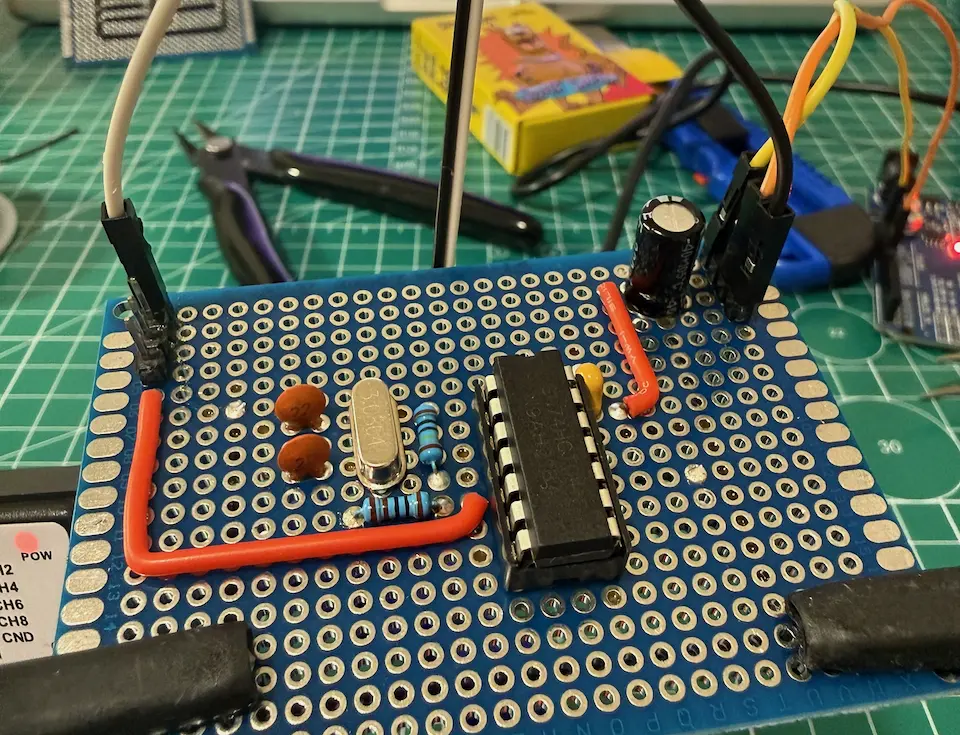

This year I started exploring electronics by building a simple Z80 computer. The CPU needs an external clock, so the oscillator became my first project. I chose a 3.6864 MHz quartz crystal. It took me several weeks to get a working circuit, move it from a breadboard to a soldered prototype, and make my first PCB.

## Circuit and components

Bill of materials:
- 74HCT04 hex inverter;
- 3.6864 MHz quartz crystal;
- 1M resistor;
- 1K resistor;
- 22pF capacitors;
- 100nF capacitor for supply decoupling.

I got the clock circuit from [RC2014](https://rc2014.co.uk/clock/) and modified it a little bit. Here is the final schematic:  

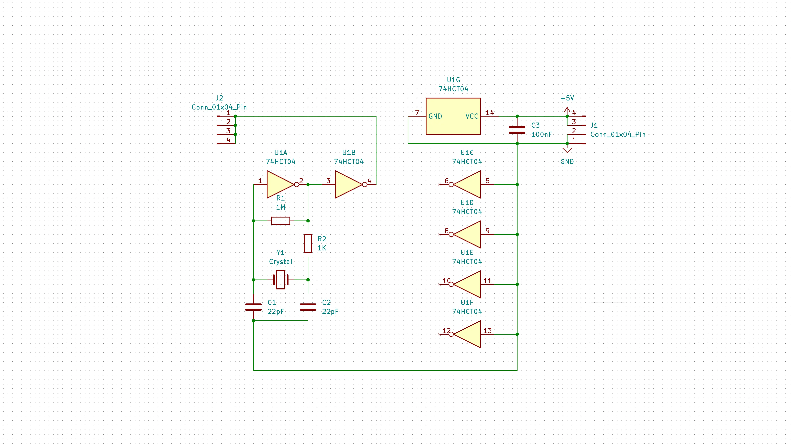

## Getting a clock signal

I first assembled the circuit on a breadboard and tried different capacitor values. I connected a USB logic analyzer to the output to inspect the clock edges.

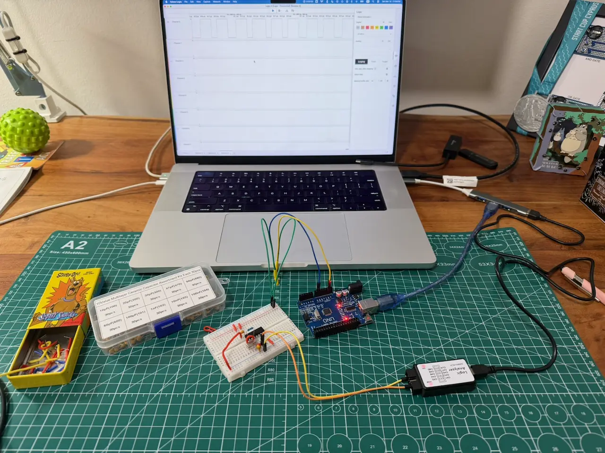

An early capture showed irregular pulse widths because of the wrong capacitor values.

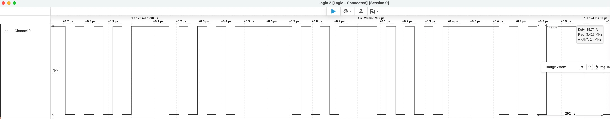

After trying different values, I settled on 22pF capacitors. The captured edges became regular. For a sample of 55 cycles, the analyzer reported a mean of 3.682 MHz.

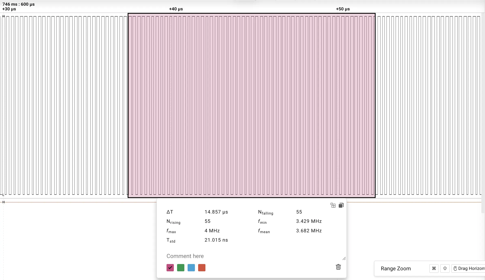

For a larger sample of 1,593 cycles, it reported a mean of 3.686 MHz, close to the crystal's nominal 3.6864 MHz.

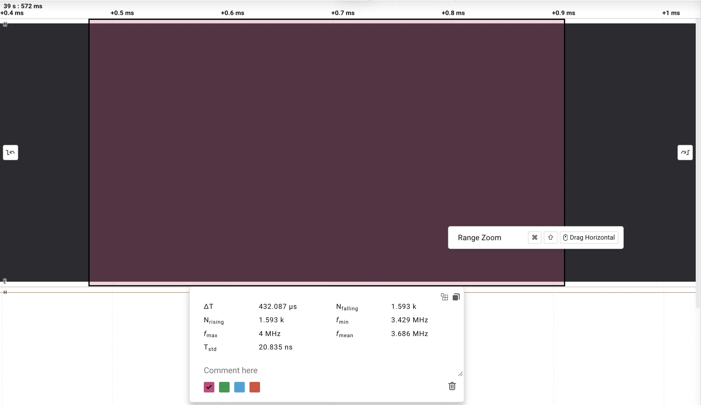

## From breadboard to soldered prototype

Once the circuit was running, I soldered a version onto a perforated board and checked it with the same logic analyzer. These photos show the test setup, the component side, and the wiring underneath.

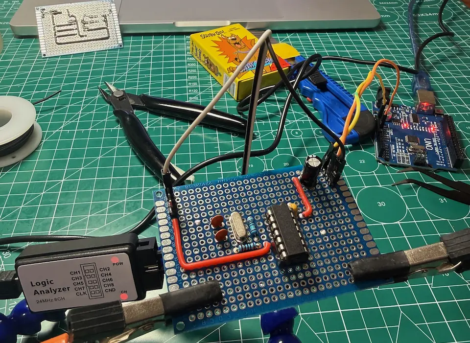

*Testing the soldered prototype with the logic analyzer.*

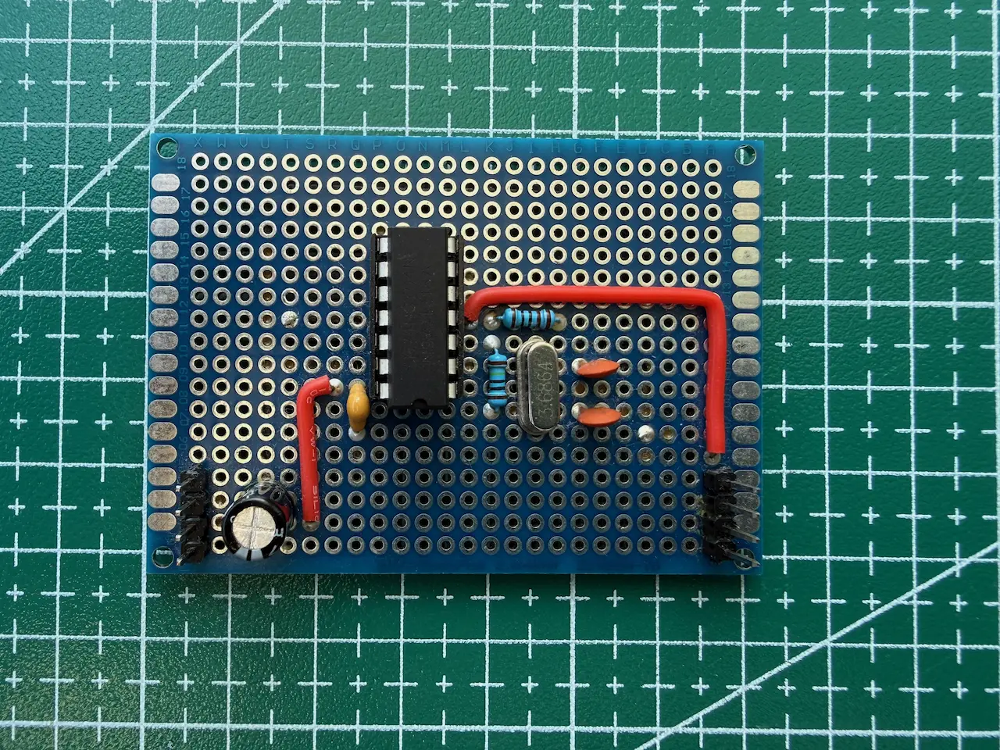

*The component side of the perforated board.*

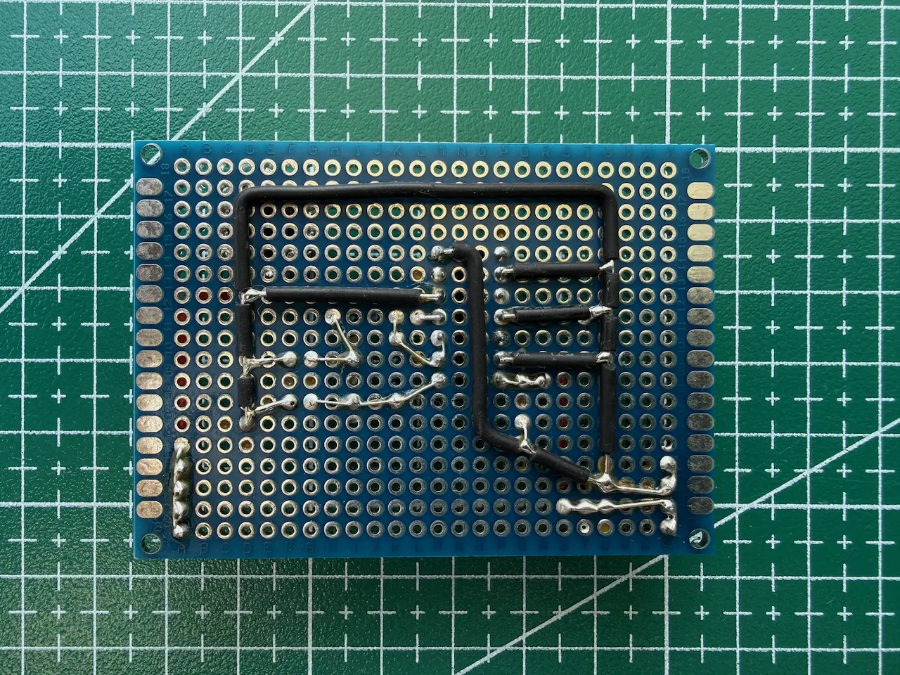

*Point-to-point wiring on the underside.*

## Making the PCB

I then laid out a small single-sided board in KiCad. I transferred the printed traces to copper, etched the board, drilled the holes, and soldered the parts.

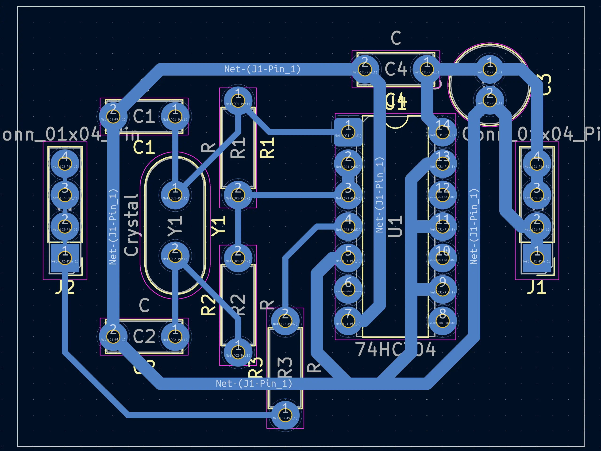

*KiCad PCB Editor.*

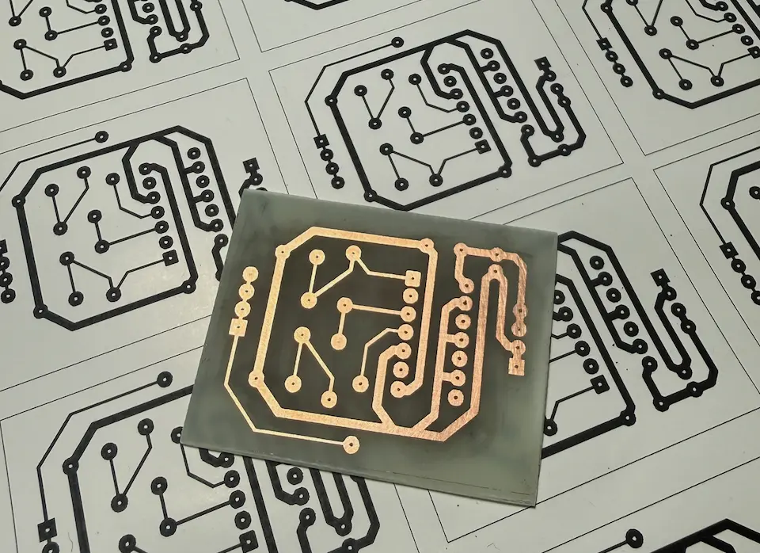

*The etched board, ready for drilling and assembly.*

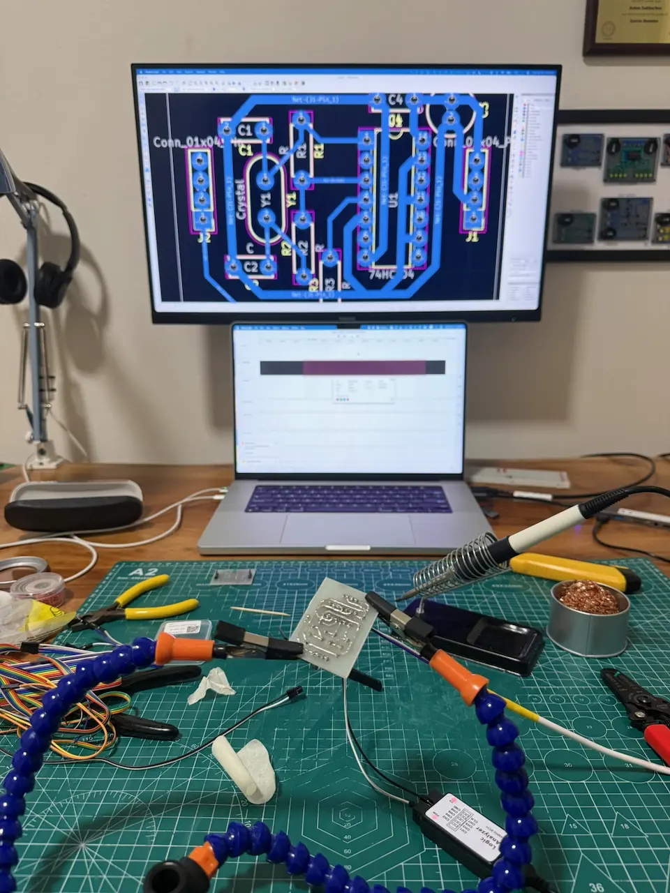

*Soldering the new PCB.*

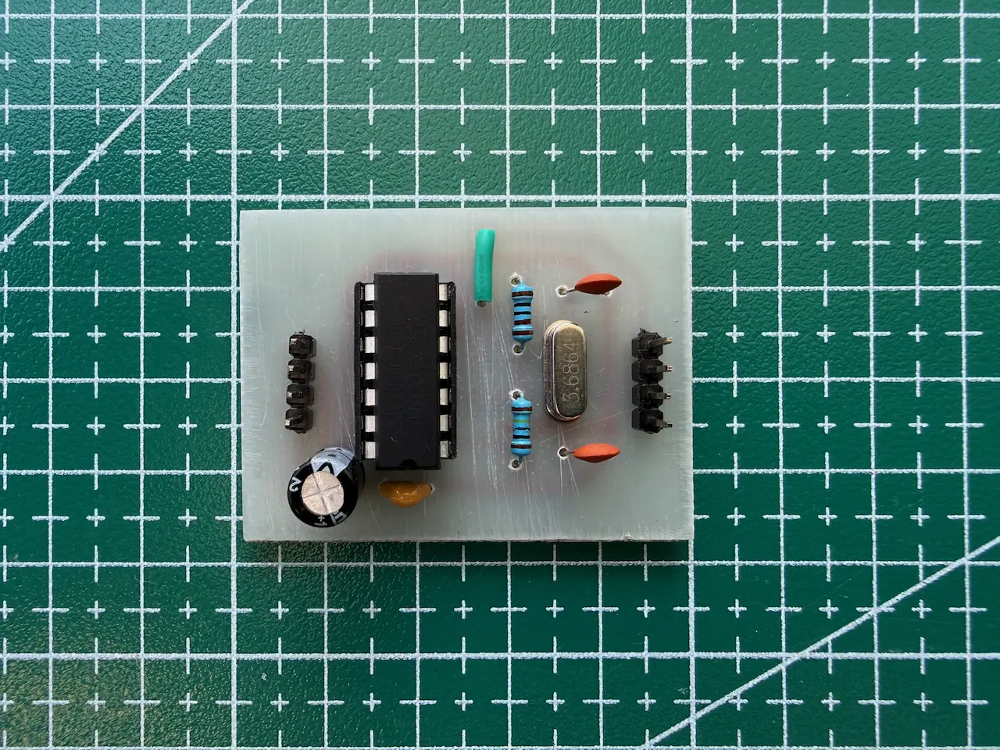

*The finished PCB, component side.*

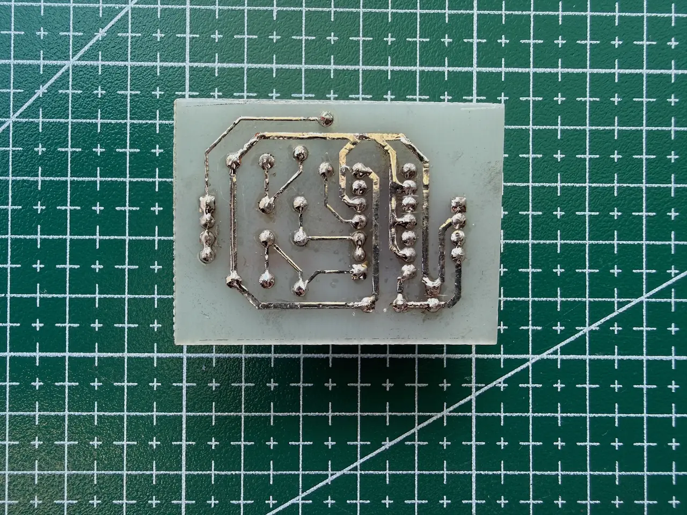

*The finished PCB, solder side.*

The finished board may look a little rough, but I think it's a good result for my first homemade PCB. 

With the clock circuit built, I can move on to the next part of the Z80 computer: a ROM programmer.
